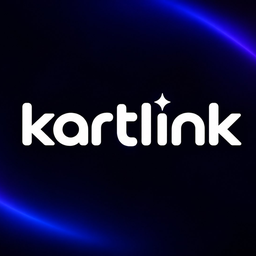

   
   

### about me ✦

hey, i’m js ✦ a student making apps, tools and experiments for fun. i build with ai and love turning ideas into things people can try.

### things i’ve made ✦

 &nbsp; **[kartlink p2p](https://github.com/js664/KartLink-P2P)** · play with friends through eglantine & playit  
&nbsp; &nbsp; &nbsp; [download ↗](https://github.com/js664/KartLink-P2P/releases/tag/v1.0.0) · [announcement ↗](https://x.com/js664_/status/2117953816008052969)

 &nbsp; **[cijferreveal](https://github.com/js664/CijferReveal)** · reveal your somtoday or magister grades one at a time  
&nbsp; &nbsp; &nbsp; [website ↗](https://js664.github.io/CijferReveal/)

### things i’m learning ✦

&nbsp; 
